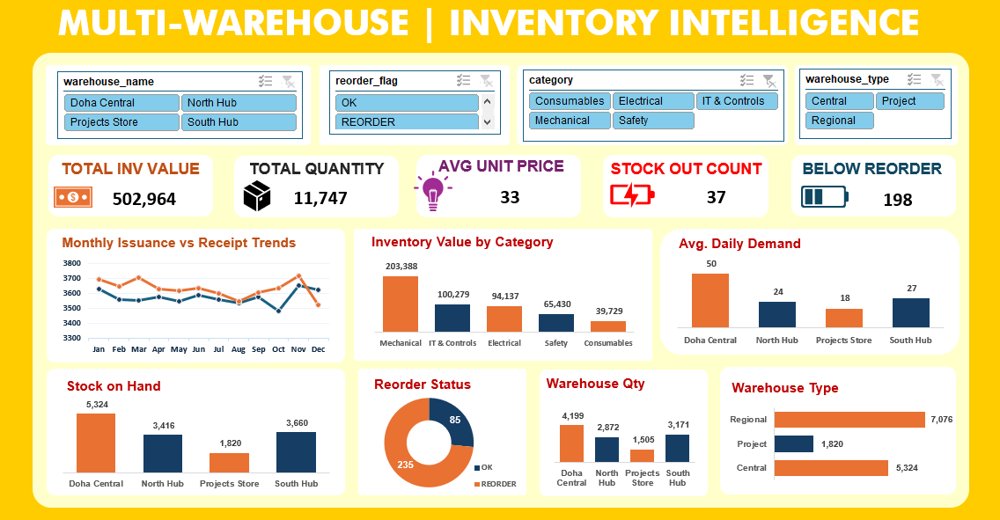

# Project 01: Multi-Warehouse Inventory Visibility
**Portfolio owner:** Olurotimi Azeez | [GitHub](https://github.com/Olurotimiazeez19)

## Executive summary
A synthetic inventory intelligence case study consolidating stock across four warehouses and 80 SKUs. The model includes on-hand, allocated and available balances, inventory value, replenishment parameters, days of cover and 12 months of movement history.

## Interactive Executive Dashboard

**Tools:** Microsoft Excel 2019, PivotTables, PivotCharts, slicers, Excel formulas and SQL.

[Download the Interactive Excel Dashboard](Multi_Warehouse_Inventory_Dashboard.xlsx)

*The dashboard uses synthetic data for portfolio demonstration purposes.*

## Business Findings and Management Recommendations

### 1. Executive Overview

The Multi-Warehouse Inventory Intelligence project analyses synthetic inventory records across four warehouse locations and 80 SKUs, providing management with visibility into stock availability, inventory valuation and replenishment requirements.

### 2. Key Performance Indicators

| KPI | Result |
|---|---:|
| Total Inventory Value | QAR 502,963.84 |
| Total On-Hand Inventory | 14,220 units |
| Available Inventory | 11,747 units |
| Allocated Inventory | 2,473 units |
| Warehouse Locations | 4 |
| Unique SKUs | 80 |
| Warehouse-SKU Records | 320 |

### 3. Key Business Findings

**Finding 1: Replenishment exposure**

The inventory dataset identifies 235 warehouse-SKU records requiring replenishment attention, including 198 classified as below reorder level and 37 classified as out of stock.

**Management Recommendation:** Prioritise stockout items, review supplier lead times and establish a structured replenishment exception report.

**Finding 2: Inventory allocation**

Of the 14,220 units held across the warehouses, 2,473 units are allocated, leaving 11,747 units available for operational requirements.

**Management Recommendation:** Monitor allocated inventory separately from physical stock to avoid overstating stock availability.

**Finding 3: Multi-warehouse stock visibility**

Inventory is distributed across four warehouse locations, creating opportunities to evaluate stock imbalances and potential transfers between locations.

**Management Recommendation:** Identify items with shortages in one warehouse and surplus stock in another before raising additional purchase orders.

**Finding 4: Inventory planning parameters**

The dataset includes average daily demand, supplier lead time assumptions, safety stock, reorder points, target stock and days of cover.

**Management Recommendation:** Validate these parameters using actual consumption patterns, supplier delivery performance and inventory service-level requirements.

### 4. Recommended Management Action Plan

| Priority | Action | Expected Business Benefit |
|---|---|---|
| High | Review out-of-stock SKUs | Reduce operational disruption |
| High | Investigate below-reorder items | Improve replenishment planning |
| High | Validate available versus allocated stock | Improve inventory accuracy |
| Medium | Evaluate inter-warehouse transfers | Reduce unnecessary purchasing |
| Medium | Review safety stock and reorder points | Improve inventory optimisation |
| Medium | Monitor monthly receipts and issues | Identify inventory movement trends |

### 5. Next Steps

The next phase of the project will focus on improving warehouse-level demand forecasting, supplier lead-time analysis, automated replenishment alerts and inventory exception reporting.

**Tools and Skills:** Microsoft Excel 2019, PivotTables, PivotCharts, Slicers, SQL, Inventory Management, Supply Chain Analytics, KPI Reporting and Data Visualisation.

## Limitations
All records are synthetic and are not actual employer or customer data. Planning settings and costs are simulated and must not be used for real procurement or financial decisions.

*Disclaimer: All inventory records and financial values are synthetic. The findings illustrate analytical techniques and do not represent actual company performance or verified cost savings.*

**Snapshot date:** 16 November 2026 | **Currency:** Illustrative QAR | **Data:** Synthetic

